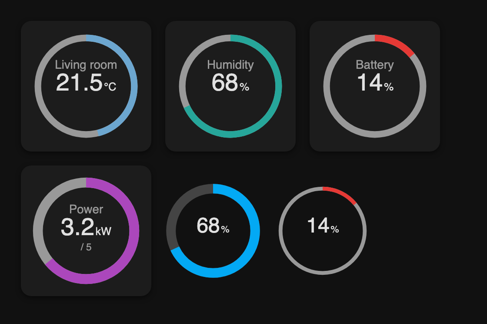

# Round Sensor Card

A circular gauge for a single sensor in Home Assistant. The ring fills between a minimum and a maximum, the value sits in the middle, and the ring color can change with the value (stepped or blended). Use it as a normal dashboard card or as an element on a picture-elements card. No dependencies, one JavaScript file, a visual editor included.

Ready-made dashboard layouts using this card: https://dashpack.judestrahm.workers.dev/

It is written as a maintained replacement for `custom-cards/circle-sensor-card`, whose last commit was in 2021 and whose open issues include [#42 "Card doesn't work in HA 2024.2"](https://github.com/custom-cards/circle-sensor-card/issues/42) and [#40 "card not working in 2023.4 beta"](https://github.com/custom-cards/circle-sensor-card/issues/40).



_The screenshot is rendered from a mocked `hass` object in a test page (see `test/`). This card has not been tested in a real Home Assistant install yet; please report anything that differs._

## Install

HACS: open HACS, search for "Round Sensor Card" under Frontend, download, reload the browser.

Manual: copy `round-sensor-card.js` to `config/www/`, then add a dashboard resource `/local/round-sensor-card.js` of type `JavaScript module`.

## Use

Add the card from the card picker ("Round Sensor Card") or in YAML:

```yaml
type: custom:round-sensor-card
entity: sensor.living_room_temperature
name: Living room
min: 10
max: 35
show_card: true
gradient: true
color_stops:
  20: "#4aa3ff"
  28: "#ffb300"
  35: "#e53935"
```

As a picture-elements element (sizing and position come from `style`):

```yaml
type: picture-elements
image: /local/floorplan.png
elements:
  - type: custom:round-sensor-card
    entity: sensor.living_room_temperature
    max: 35
    style:
      top: 30%
      left: 40%
      width: 70px
      height: 70px
```

| Key | Default | Description |
| --- | --- | --- |
| `entity` | required | Any entity with a numeric state or numeric attribute. |
| `name` | none | Small label above the value. |
| `min`, `max` | `0`, `100` | Ring range. The ring is clamped to it. |
| `attribute` | none | Show this attribute instead of the state. |
| `attribute_max` | none | Use this numeric attribute of the entity as the maximum. |
| `show_max` | `false` | Print `/ max` under the value. |
| `units` | entity unit | Override the unit. A blank string (`" "`) hides it. |
| `decimals` | auto | Fixed number of decimals; by default up to 2. |
| `show_card` | `false` | Wrap the gauge in an `ha-card`. Leave off for picture-elements. |
| `stroke_width`, `stroke_bg_width` | `6`, same | Ring and track thickness (1-20). |
| `stroke_color`, `stroke_bg_color` | `#03a9f4`, `#999999` | Ring and track colors. |
| `fill` | `transparent` | Color inside the ring. |
| `color_stops` | none | Map of value to color. Step mode: the lowest stop at or above the reading wins; past the last stop the last color stays. |
| `gradient` | `false` | Blend between stops (stops given as `#rgb` or `#rrggbb`; other color forms fall back to step). |
| `font_style` | none | CSS for the value: `color`, `font-size`, `font-family`, `font-weight`, `font-style`, `text-shadow`, `letter-spacing`, `text-transform`. Other properties are ignored. |
| `tap_action` | `more-info` | `more-info`, `navigate` (`navigation_path`), `url` (`url_path`), `call-service` / `perform-action` (`service` or `perform_action`, `data`, `target`), or `none`. |

The editor covers the common options; `color_stops` and `font_style` are YAML only.

## Migrating from `custom:circle-sensor-card`

Change `type: custom:circle-sensor-card` to `type: custom:round-sensor-card` and the resource URL to this card's file. These keys carry over with the same meaning: `entity`, `name`, `min`, `max`, `show_card`, `stroke_width`, `stroke_color`, `stroke_bg_width`, `stroke_bg_color`, `color_stops`, `gradient`, `units`, `attribute`, `attribute_max`, `show_max`, `font_style` (restricted to the properties above), `fill`.

Differences to know about:

- `fill` defaults to `transparent` instead of a translucent white disc, so text stays readable on dark themes. Set it explicitly if you want the old look.
- `font_style` only accepts the listed properties.
- Tapping opens the entity's more-info dialog by default (configurable with `tap_action`).
- Everything else in the old card's options that is not listed above is not supported.

## Development

```
npm install
npm test          # jsdom tests against a mocked hass
npm run screenshot  # needs Playwright's Chromium; set CHROME_PATH to use another build
```

MIT licensed. Independent implementation; no code was copied from other cards.
